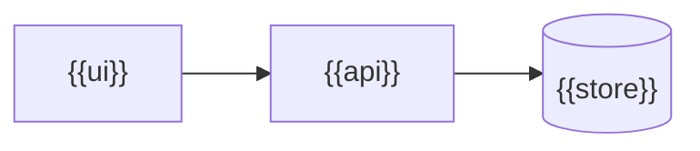

# Codebase Map — {{PROJECT_NAME}}

> Updated: {{DATE}} · Last feature: {{FEATURE_ID}}
> The lead maintains this (sole reader/writer during the loop); update-docs refreshes it
> at close-out. Generators do NOT read it. Keep it compact and current every run.

## Overview
{{2-4 lines: what this system is and does.}}

## System map

## Modules
| Module | Path | Responsibility | Key entry points |
|---|---|---|---|
| {{name}} | `{{src/…}}` | {{what it owns}} | `{{file:symbol}}` |

## How it works (per workflow)
### {{workflow / use-case name}}
1. {{entry point}} — {{what happens, which module}}
2. {{next step}} — {{…}}
3. {{result}} — {{…}}

## Business glossary / code values
| Value | Where | Meaning |
|---|---|---|
| `001` | {{table.column}} | {{e.g. pending}} |

## Recent changes
| Feature | Date | What moved |
|---|---|---|
| {{FEATURE_ID}} | {{DATE}} | {{modules added/changed}} |
